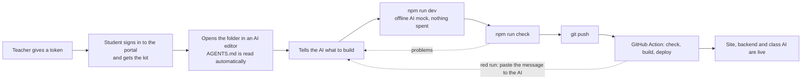
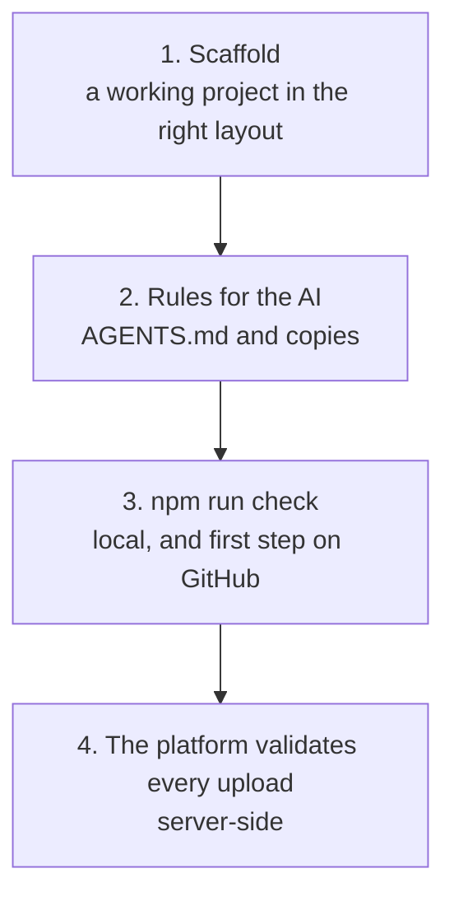

# The student kit: from a token to a deployed app

A generic starter project that a student opens in their AI editor (Antigravity, Cursor, VS Code with Copilot, Claude Code, Windsurf, ...). It makes the AI build **within the platform's architecture**, and every push deploys itself. The teacher hands out one thing: **a token**.

Companion to [END_TO_END.md](END_TO_END.md), [AI_CONNECTOR.md](AI_CONNECTOR.md) and [../student/CICD.md](../student/CICD.md). Code: [`../starter/`](../starter/).

## 1. The student's journey



In words: sign in, get the kit, open it in an AI editor, describe the app, try it locally, check, push. One-time GitHub step: add the token as the repository secret `PORTAL_TOKEN` (the portal gives deep links; the token is never written into a file). After that every push to `main` deploys.

## 2. What is in the kit

```
README.md  PROMPTS.md          quickstart (6 steps) and starter prompts
AGENTS.md                      the platform's rules for the AI (canonical)
GEMINI.md  CLAUDE.md           copies / import for Gemini CLI + Antigravity and Claude Code
.claude/skills/class-platform  .cursor/rules/  .github/copilot-instructions.md  .windsurfrules   the same rules for other editors
frontend/                      working React + Vite + TypeScript site (calls /api, asks the AI through the backend)
backend/app.py  class_ai.py    working Python function and the class AI helper
variants/node-backend/         the same backend in Node 22
tools/                         check.mjs (platform check), dev.mjs + dev servers (local run), doctor.mjs
.github/workflows/deploy.yml   check, then deploy on every push to main
portal-deploy.mjs              the CLI the workflow runs (the same file the portal offers)
platform.json  kit-manifest.json   kit version and sha256 of every file
```

Two files are **single-source** (copied from the platform repo at build time, never edited in the template): `portal-deploy.mjs` and `class_ai.py` / `class_ai.mjs`. A test asserts the kit copies are byte-identical to the platform's.

## 3. How the architecture is enforced (four layers)



1. **Scaffold:** the AI edits something that already builds and deploys; it does not invent a project.
2. **Rules** (`starter/rules/AGENTS.md`): static frontend plus one function; relative `/api` calls; standard library only (nothing is installed on the platform); limits (10 s, 25 s with AI, 256 MB, 5 MB zip); secrets only in portal environment variables; AI only through the backend with `class_ai`; the token never in a file; no databases or server rendering.
3. **`npm run check`** fails the build when the rules are broken (table below). It prints a `fix:` line for each problem and tells the student to paste the output to their AI.
4. **The platform** still validates every upload (paths, symlinks, `.env`, entry file, sizes) and refuses bad ones.

### The checker's rules

| Area | Error (blocks the deploy) | Warning |
|---|---|---|
| Layout | no `frontend/package.json`, no `build` script, no `index.html`, neither folder | no lockfile, backend-only project |
| Backend | no or two entry files, a `.env` file, over 500 files / 50 MB / 5 MB zipped, non-standard-library imports (Python, via the real parser), imports of packages that are not bundled (Node), syntax errors | Python not found (imports unchecked) |
| Frontend | an AI service called from the browser (OpenAI, OpenRouter, Anthropic, Google, ...), `localhost` URLs, `VITE_` variables holding a key/secret/token/password | |
| Secrets anywhere | portal token (`mds_...`), AI keys, AWS keys, GitHub tokens, private keys | |
| Git | `.gitignore` missing or not excluding `.env`, a tracked `.env` or `*.local` | `node_modules` tracked |
| Wiring | | no workflow runs `portal-deploy.mjs`, `portal-deploy.mjs` missing, Node older than 22 |

Mentions in comments and placeholders like `mds_xxxxxxxx` do not trigger errors (tested). The checker's backend limits equal the platform's real ones (a test pins them).

## 4. Developing locally

`npm run dev` starts the site (http://localhost:3000) and the backend (http://127.0.0.1:8788); the site forwards `/api` to it, so the browser sees one address exactly like on the platform. Both backends (Python and Node) reload changed files without a restart. **The class AI is an offline mock locally** (answers start with `[mock AI]`), so students iterate without spending their allowance; setting their own `OPENAI_*` variables in `.env.local` uses a real model. `npm run doctor` checks Node 22, Python 3.12 and git.

## 5. The class AI helper (`class_ai`)

Two lines in the student's backend: `from class_ai import ask` / `answer = ask("...")` (Node: `import { ask } from './class_ai.mjs'` / `await ask('...')`). It reads the three variables the platform sets when the teacher switches the AI on, and raises `AiError` with a friendly message and a kind (`not_enabled`, `cap_reached`, `disabled`, `busy`, `timeout`, `provider_error`); `default="..."` returns a fallback text instead. It retries once on 429/5xx, uses a 20 s timeout, never prints or logs the key or prompts, and is tested in both languages against a local fake service. Details of the connector itself: [AI_CONNECTOR.md](AI_CONNECTOR.md).

## 6. Security

| Concern | How it is handled |
|---|---|
| The token ends up in git | Never in the kit; the rules forbid writing it to any file; the checker blocks `mds_...` strings; it lives only in the GitHub secret `PORTAL_TOKEN` |
| The AI key ends up in the browser | The checker blocks AI endpoints and `VITE_` secrets in `frontend/`; the rules route all AI calls through the backend |
| A student ships a `.env` | Checker blocks it in `backend/` and in git; the platform refuses it too |
| The kit itself | Generic and safe for a public repository: a test scans every kit file for tokens, keys, emails and personal paths; a manifest lists the sha256 of every file |
| Hidden code | No code is injected into a student's package: `class_ai` is a visible file in `backend/` |
| Deploy abuse | The token only deploys to the student's own site and function; expiry, revoke, the backend switch and the AI cap all still apply |

## 7. Publishing the kit

Build it anywhere: `node starter/build-kit.mjs <folder>` (add `--force` to replace a non-empty folder). The folder is the whole kit. Publish it as a **public GitHub template repository** (students click "Use this template") by pushing that folder's contents to the template repo; there is nothing secret in it. Rebuild and push when `starter/` or the single-source files change. (The portal's "Start here" card and `kit update` command come next: see section 9.)

## 8. Testing

| Test | What it proves |
|---|---|
| `tests/test_class_ai.py`, `test_class_ai.mjs` | the helper in both languages: success, every error kind, retries, timeout, mock, `default=`, no key or prompt in any output |
| `tests/test_kit.mjs` | kit contents; all rule copies identical; single-source files identical; no secrets or personal data; limits equal the platform's; each checker rule fires on a deliberate mistake (about 30 fixtures) and stays quiet on comments and placeholders; both dev servers run with hot reload and the AI mock |
| `tests/test_kit_e2e.mjs` | build the kit, `npm ci`, deploy it with its own `portal-deploy.mjs` to the whole dev portal, switch the AI on as the teacher: `ask()` reaches the model with the student's own key; switch off gives a friendly `not_enabled`; the Node variant works too (needs network for npm) |
| Mutation checks | breaking the helper's error mapping, retry, key scrubbing, mock rules and the checker's rules is caught |

## 9. What comes next

1. **Portal "Start here" card:** kit download, a "paste your GitHub repo" box that gives deep links to the secrets and Actions pages, and a checklist that ticks as things happen.
2. **`kit update`:** fetch newer rules and tools into an existing project without touching the student's code (the manifest makes this safe).
3. **AI evaluation:** run fresh AI agents on the kit with typical prompts and measure how often `check`, the build and a live deploy pass; tune `AGENTS.md` until it is reliable.
4. **Deploy activity history** so the portal confirms "your GitHub push went live".
5. **Pilot** with two or three real students.
